# Lab5Web — Praktikum 5: JavaScript Dasar dan Manipulasi HTML

**Mata Kuliah:** Pemrograman Web (Pertemuan 6)
**Nama / NIM / Kelas:** Laurensius Rivaldo Nahak / 312310727 / I251D

## Tujuan
1. Memahami sintaks dasar JavaScript dan cara menyisipkannya pada HTML.
2. Menggunakan variabel, tipe data, operator, percabangan, perulangan, dan function.
3. Menampilkan informasi melalui console, alert, prompt, dan elemen HTML.
4. Memanipulasi konten serta gaya elemen HTML.
5. Membuat interaksi form dan validasi input.

## Struktur Berkas
| Berkas | Isi |
|---|---|
| `index.html` | Halaman Latihan 1–8, eksperimen mandiri, dan form validasi (Tugas H.7) |
| `script.js` | Seluruh kode JavaScript untuk `index.html` |
| `kalkulator.html` + `kalkulator.js` | Mini Project: Kalkulator Nilai Mahasiswa |

## Cara Menjalankan
1. Unduh/clone repository ini.
2. Buka `index.html` di browser (klik dua kali atau gunakan Live Server di VS Code).
3. Buka Console melalui klik kanan → Inspect/Periksa → Console.
4. Klik tombol pada tiap bagian untuk menjalankan latihan.

## Hasil Latihan

**Latihan 1 — Output.** Teks pada halaman berubah menjadi "Hello World" dan pesan yang sama dikirim ke Console.
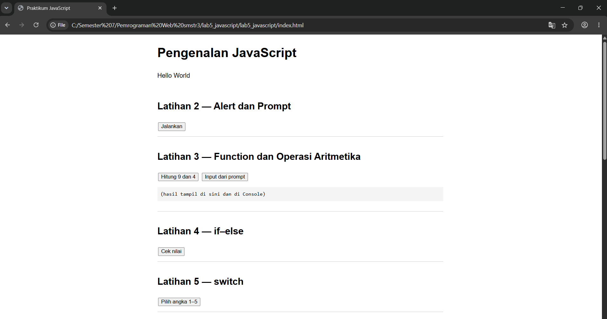
Console menampilkan Hello World (dari `script.js:3`):
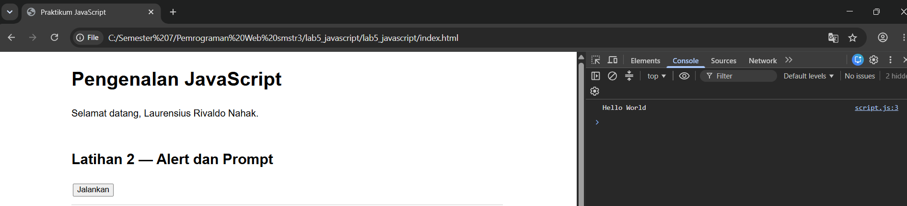

**Latihan 2 — Alert dan prompt.** Dialog `prompt` meminta nama; setelah OK, `alert` menyapa dan teks halaman berubah menjadi "Selamat datang, ...". Jika Cancel atau kosong, muncul "Nama belum diisi.".
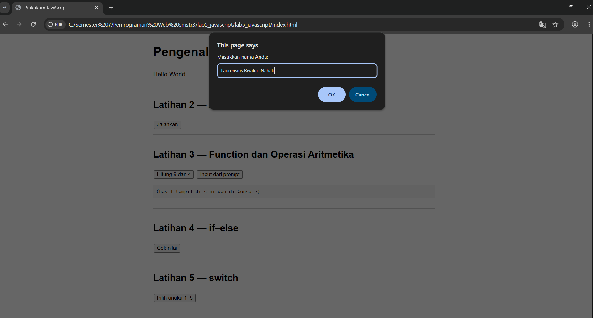
Setelah OK, teks halaman berubah:
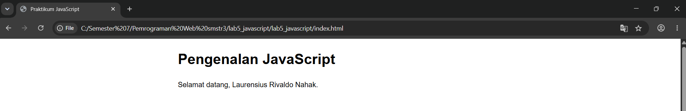

**Latihan 3 — Function dan operasi aritmetika.** `operasiDasar(9, 4)` menampilkan 13, 5, 36, 2.25, dan 1 (terlihat pada kotak hasil di belakang dialog).
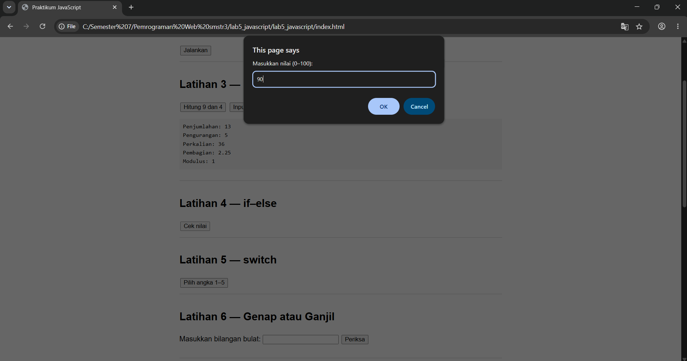

**Latihan 4 — if–else.** Dialog `prompt` meminta nilai 0–100 (diisi 90 → "Lulus"). Nilai di bawah 60 → "Belum lulus"; kosong, huruf, atau di luar 0–100 → "Input nilai tidak valid".
(Gambar di atas juga menampilkan dialog Latihan 4.)

**Latihan 5 — switch.** Dialog meminta angka 1–5 (diisi 4 → "Bilangan empat"); selain itu → "Pilihan tidak tersedia".
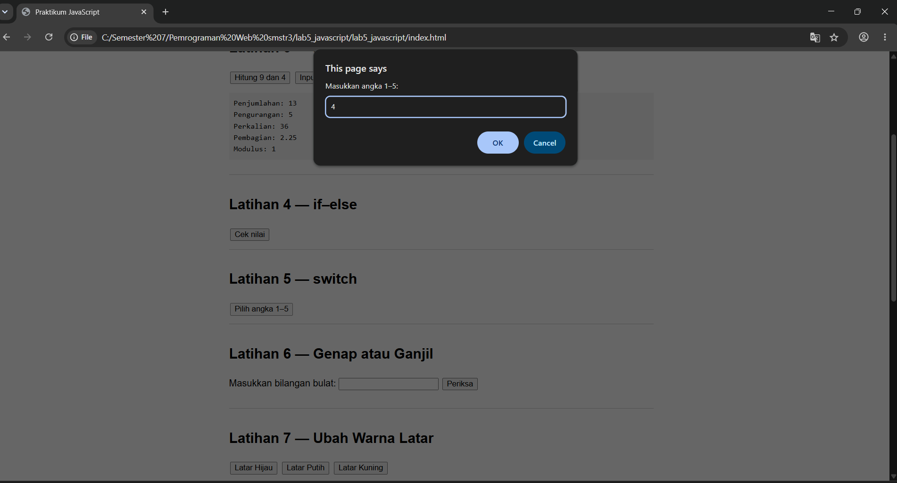

**Latihan 6 — Genap atau ganjil.** Input 2 → "Bilangan genap"; input -1 → "Bilangan ganjil". Desimal dan input kosong → "Masukkan bilangan bulat yang valid.".
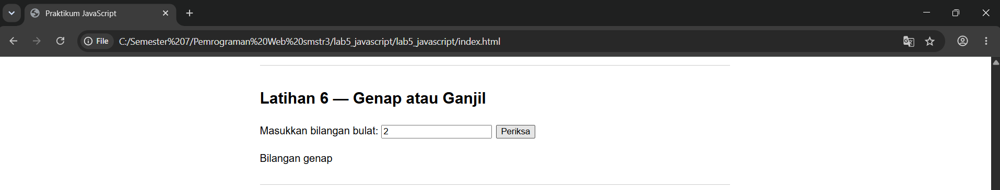

**Latihan 7 — Warna latar.** Tombol "Latar Hijau" mengubah `backgroundColor` body menjadi `lightgreen`.
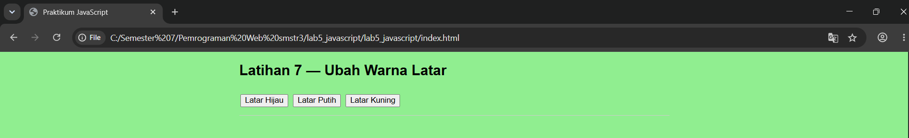

**Latihan 8 — Checkbox menu.** Semua lima menu dicentang → Total Rp13.000 (5.000 + 500 + 2.500 + 3.000 + 2.000).
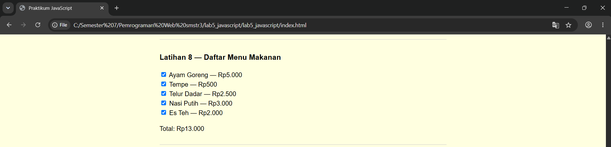

## Mini Project — Kalkulator Nilai
Bobot: Tugas 30%, UTS 30%, UAS 40%. Predikat: A ≥85, B ≥75, C ≥60, D ≥50, E <50. Lulus jika nilai akhir ≥60.

Tampilan awal:
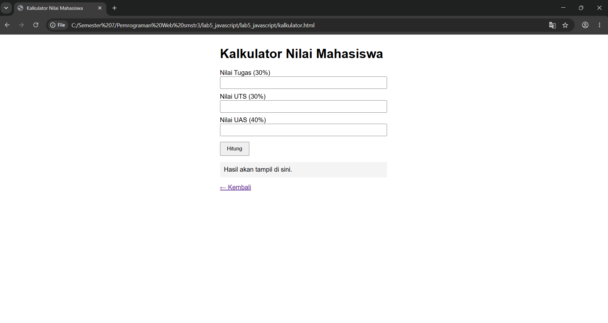

Input 90, 85, 80 menghasilkan nilai akhir 84.50, predikat B, status Lulus:
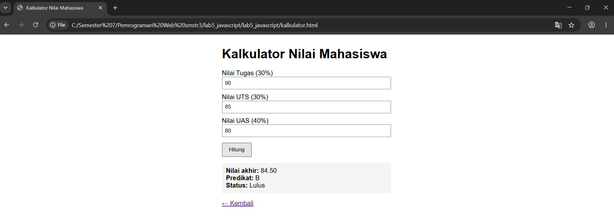

Skenario 2 (90, 90, 90 → 90.00, A, Lulus):
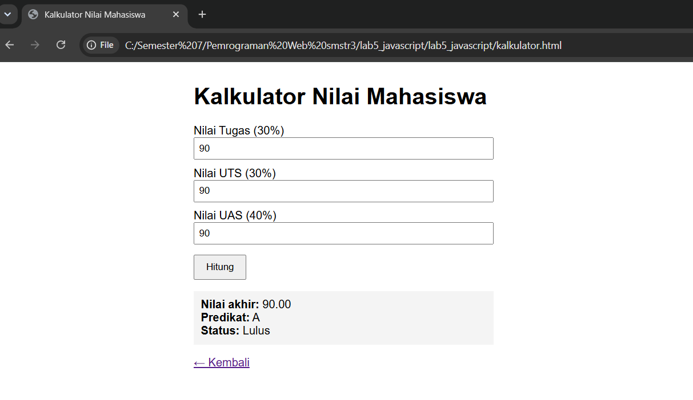

Skenario 3 (50, 40, 55 → 49.00, E, Belum lulus):
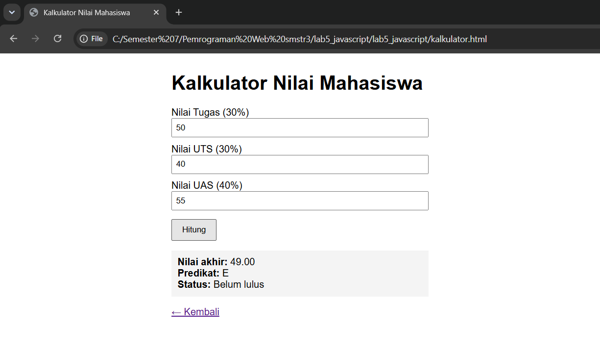

| Skenario | Tugas | UTS | UAS | Nilai Akhir | Predikat | Status |
|---|---|---|---|---|---|---|
| 1 | 90 | 85 | 80 | 84.50 | B | Lulus |
| 2 | 90 | 90 | 90 | 90.00 | A | Lulus |
| 3 | 50 | 40 | 55 | 49.00 | E | Belum lulus |
| 4 | 105 | 80 | 80 | — | — | Ditolak (di luar 0–100) |

## Eksperimen Mandiri
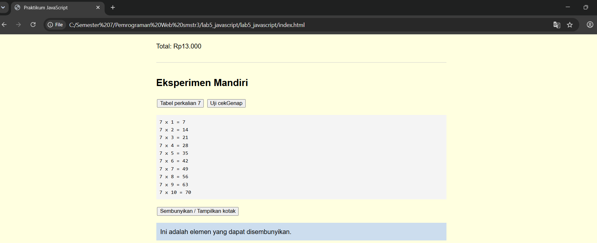
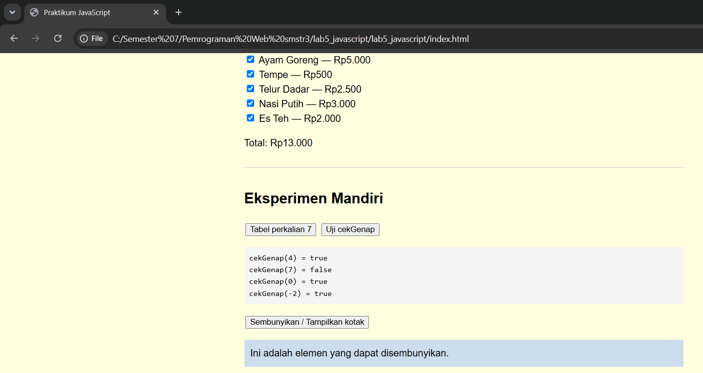
1. Latihan 3 menerima dua nilai dari `prompt` dan dikonversi dengan `Number()` (`eksperimen1()`).
2. Tabel perkalian 7 dengan perulangan `for` (`tabelPerkalian(7)`).
3. `cekGenap(angka)` mengembalikan `true` jika genap.
4. Validasi form agar kolom tidak boleh kosong (`validasiForm()`).
5. Latihan 8 ditambah dua menu: Nasi Putih (Rp3.000) dan Es Teh (Rp2.000).
6. Tombol untuk menyembunyikan/menampilkan elemen (`toggleKotak()`).

## Jawaban Pertanyaan

**1. Perbedaan `console.log()`, `alert()`, `prompt()`, dan `textContent`/`innerHTML`.**
- `console.log()` menulis pesan ke Console developer tools; dipakai untuk debugging dan tidak terlihat pengunjung biasa.
- `alert()` menampilkan kotak dialog berisi pesan dan menghentikan interaksi sampai OK ditekan.
- `prompt()` menampilkan dialog yang meminta masukan; mengembalikan string, atau `null` jika Cancel.
- `textContent`/`innerHTML` mengubah isi elemen di halaman. `textContent` menyisipkan teks apa adanya, sedangkan `innerHTML` menafsirkan string sebagai HTML (hati-hati bila isinya dari input pengguna).

**2. Perbedaan `let` dan `const`.**
`let` untuk variabel yang nilainya boleh ditetapkan ulang, `const` untuk yang tidak boleh. Contoh: `let umur = 20; umur = 21;` valid, sedangkan `const nama = "Rani"; nama = "Dina";` menghasilkan error.

**3. Perbedaan `==` dan `===`.**
`==` membandingkan nilai setelah konversi tipe otomatis (`5 == "5"` → `true`). `===` membandingkan nilai sekaligus tipe tanpa konversi (`5 === "5"` → `false`). Disarankan memakai `===` agar hasil lebih dapat diprediksi.

**4. Fungsi `if–else` dan `switch`.**
`if–else` memilih blok kode berdasarkan kondisi logis, cocok untuk rentang atau kondisi majemuk (mis. nilai ≥60). `switch` memilih satu tindakan dari sejumlah nilai tertentu, cocok untuk pilihan diskret (mis. menu 1–5). `break` mencegah eksekusi berlanjut ke `case` berikutnya.

**5. Fungsi parameter dan `return`.**
Parameter adalah variabel penerima data masukan saat function dipanggil, sehingga function dapat dipakai ulang dengan data berbeda. `return` mengembalikan hasil ke pemanggil dan mengakhiri eksekusi function. Contoh: `hitungLuas(8, 4)` mengembalikan 32.

**6. Memilih elemen dengan `document.getElementById()`.**
Method ini mencari elemen yang atribut `id`-nya sama dengan string yang diberikan dan mengembalikan elemen tersebut (atau `null` jika tidak ada). Contoh: `document.getElementById("pesan").textContent = "Halo";`. Elemen harus sudah dimuat sebelum script berjalan, karena itu `<script>` diletakkan di akhir `<body>`.

**7. Validasi form nama tidak kosong dan nilai 0–100.**

Nilai 150 ditolak:
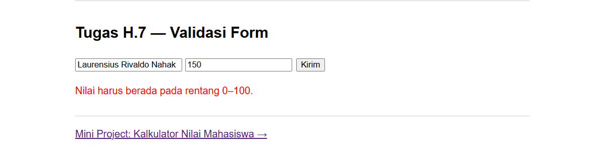
Lihat fungsi `validasiForm()` pada `script.js` dan form "Tugas H.7" pada `index.html`.
